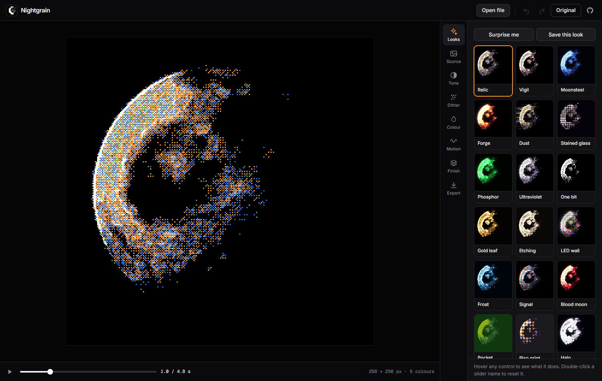
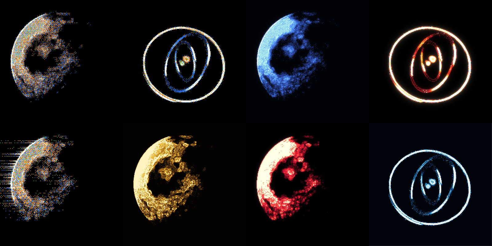

# Nightgrain

Turn any image, GIF or video into shimmering dithered pixel art: a handful of bright colours on a dark field, with grain that never sits still.

**Open it: https://winchxyz.github.io/nightgrain/**




Everything runs in your browser. Your files are never uploaded.

## What it does

- **Any source.** Images (PNG, JPEG, WebP, SVG and more), animated GIF and WebP, and video. Drop a file, paste from the clipboard, or start with a built-in scene.
- **18 dither patterns.** Bayer 2 to 16, blue noise, static, halftone dots, lines, diagonals, crosshatch, and seven kinds of error diffusion (Floyd-Steinberg, Atkinson, Stucki, Jarvis, Burkes, Sierra, Sierra Lite).
- **Real colour mixing.** Ordered patterns mix several palette colours to reach a tone, so grey steel becomes blue, orange and green dots instead of flat grey.
- **22 palettes**, plus your own: edit every colour, pull a palette out of the picture, shift hues, or roll a random one.
- **18 ready-made looks** with live previews on your own picture, a Surprise me button, and your own saved looks.
- **Motion.** Shimmering grain, sparkles, a glint of light that sweeps across the subject, breathing brightness, drifting patterns, and six ways for the picture to assemble itself.
- **Picture controls.** Exposure, contrast, shadow and highlight cuts, midtones, saturation, hue, warmth, outlines, sharpening, background removal, corner fade and dust trails.
- **Finish.** Pixel shapes (tiles, dots, diamonds, rows, columns), glow, scanlines, colour fringe and margins.
- **Export.** PNG up to 4096 px, GIF, and MP4 video rendered frame by frame. GIFs with plain square pixels keep the exact palette and stay small.
- Undo and redo, hold to compare with the original, drag and scroll to frame the picture, and a link that carries a look to someone else.



## Shortcuts

| Key | Action |
| --- | --- |
| Space | Play or pause |
| Ctrl+Z, Ctrl+Shift+Z | Undo, redo |
| Ctrl+S | Save PNG |
| Ctrl+O | Open a file |
| Double-click a slider name | Reset that slider |

## Run it locally

No build step. Serve the folder with any static server:

```bash
node tools/serve.mjs
```

Then open http://localhost:8930.

## How it works

Each frame goes through one pipeline on a small pixel grid:

1. The source frame is drawn onto the grid with your framing.
2. Tone, colour, sharpening and outlines are applied on float RGB planes.
3. Masks (background removal, corner fade, entrance) and dust trails shape what stays lit.
4. The dither step turns the picture into palette indices. Ordered patterns use a cached colour-mixing table (pattern dithering in the style of Thomas Knoll); diffusion spreads the error to neighbours.
5. The grid is scaled up with hard edges, then pixel shape, glow and scanlines are added.

The code is plain ES modules with no dependencies. MP4 export uses WebCodecs and loads [mp4-muxer](https://github.com/Vanilagy/mp4-muxer) on demand.

## Browser support

Current Chrome, Edge, Firefox and Safari. MP4 export needs WebCodecs; where it is missing the app records WebM instead.

## Credits

Fonts: [Inter](https://rsms.me/inter/) and [Geist Mono](https://vercel.com/font), both under the SIL Open Font License.

## License

MIT
