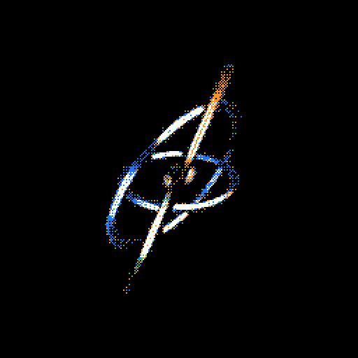
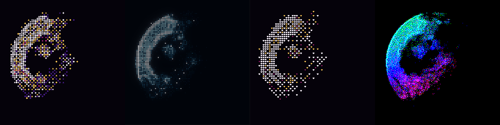
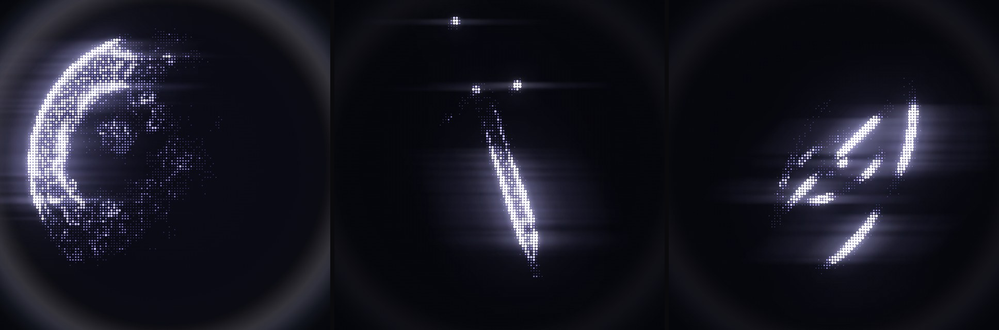
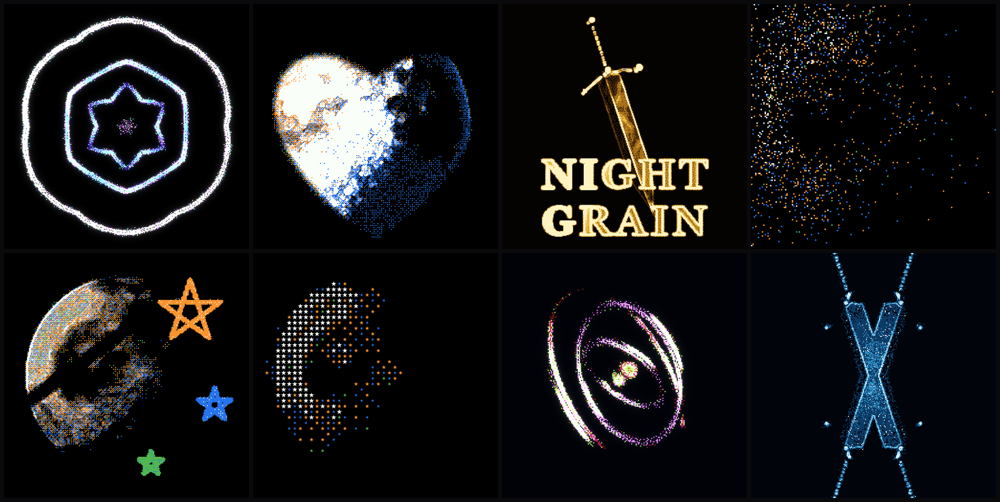

# Nightgrain

Turn any image, GIF or video into shimmering dithered pixel art: a handful of bright colours on a dark field, with grain that never sits still.

**Open it: https://winchxyz.github.io/nightgrain/**




Everything runs in your browser. Your files are never uploaded.

## What it does

- **Any source.** Images (PNG, JPEG, WebP, SVG and more), animated GIF and WebP, and video. Drop a file, paste from the clipboard, or start with a built-in scene.
- **18 dither patterns.** Bayer 2 to 16, blue noise, static, halftone dots, lines, diagonals, crosshatch, and seven kinds of error diffusion (Floyd-Steinberg, Atkinson, Stucki, Jarvis, Burkes, Sierra, Sierra Lite).
- **Real colour mixing.** Ordered patterns mix several palette colours to reach a tone, so grey steel becomes blue, orange and green dots instead of flat grey.
- **24 palettes**, plus your own: edit every colour, pull a palette out of the picture, shift hues, or roll a random one. Three sliders turn, wash out or lighten the whole palette at once.
- **Tint.** Colour the picture itself with one colour, a gradient, a rainbow or by brightness, so different palette colours light up in different places. The tint can flow through the picture over the loop.
- **18 pixel shapes.** Squares, tiles, dots, rings, diamonds, plus signs, crosses, stars, sparks, hearts, triangles, hexagons, moons, arrows and lines. Use one, give each palette colour its own, or scatter several at random. Turn them, space them, and let their size follow brightness.
- **Your own pixel.** Upload a small image or type a letter or emoji, and every pixel of the art becomes a copy of it, coloured by the palette or in its own colours.
- **Palette order and muting.** Drag colours into a new order, and switch a single colour off without deleting it.
- **25 ready-made looks** with live previews on your own picture, a Surprise me button, and your own saved looks.
- **Motion.** Shimmering grain, sparkles, a glint of light that sweeps across the subject, breathing brightness, drifting patterns, and six ways for the picture to assemble itself.
- **Touch.** The picture answers to the mouse or a finger: light that follows it, ripples on water, paint that smears, pixels that move out of the way. It happens before the dither, so the reaction is made of the same pixels. Record what you do as a video.
- **Keyframes.** Any slider with a ◆ can change over the loop: pin a value at one moment, another value at another, and the setting glides between them. The loop closes without a seam.
- **Break apart.** The picture bursts into loose pixels that fly outward, fall, rise, blow away or swirl, and gathers itself back.
- **Colour cycling.** The palette turns through the colour wheel, or its colours swap places step by step, while the picture stays.
- **Brush and eraser.** Paint lit pixels in any colour straight onto the picture, erase parts of it, or restore them. Strokes are dithered like everything else.
- **Text.** Words in three typefaces that go through the same processing as the picture. Drag them into place.
- **Mirror and kaleidoscope.** Mirror the picture left to right, top to bottom or four ways, or fold it into a kaleidoscope with up to 16 segments.
- **Frame shape.** Cut the picture to a rounded square, circle, diamond, hexagon, star, heart, or the outline of your own image.
- **Camera.** Use the webcam as a live source and record a clip from it.
- **Picture controls.** Exposure, contrast, shadow and highlight cuts, midtones, saturation, hue, warmth, outlines, sharpening, background removal, corner fade and dust trails.
- **Finish.** Glow, scanlines, colour fringe and margins.
- **Highlights.** Bloom that spills from the brightest cells with its own tint, thin sideways streaks, and a lens ring around the frame that brightens with the picture. A sweeping glint can leave everything outside it in the dark.
- **Export.** PNG up to 4096 px, GIF, and MP4 video rendered frame by frame. GIFs with plain square pixels keep the exact palette and stay small. Also animated PNG with real transparency, SVG for print and plotters, sprite sheets, and Telegram video stickers (WebM with a transparent backdrop, fitted to Telegram's size limit).
- **Search.** Press `/` and type to find any setting, look, palette or export in every section at once. Each section has its own Reset.
- **Batch.** Give a whole set of files the current look and get them back in one ZIP.
- Undo and redo, hold to compare with the original, drag and scroll to frame the picture, and a link that carries a look to someone else.




Highlights: the Lumen look, round pixels sized by brightness with bloom, streaks and a lens ring:



Kaleidoscope, frame shape, text, break apart; brush and eraser, your own pixel, colour cycling, mirror:



## Shortcuts

| Key | Action |
| --- | --- |
| Space | Play or pause |
| / | Search settings |
| Ctrl+Z, Ctrl+Shift+Z | Undo, redo |
| Ctrl+S | Save PNG |
| Ctrl+O | Open a file |
| Double-click a slider name | Reset that slider |

## Run it locally

No build step. Serve the folder with any static server:

```bash
node tools/serve.mjs
```

Then open http://localhost:8930.

## How it works

Each frame goes through one pipeline on a small pixel grid:

1. The source frame is drawn onto the grid with your framing.
2. Tone, colour, sharpening and outlines are applied on float RGB planes.
3. An optional tint recolours the picture. Masks (background removal, corner fade, frame shape, entrance), the brush and eraser layers, and dust trails shape what stays lit.
4. The dither step turns the picture into palette indices. Ordered patterns use a cached colour-mixing table (pattern dithering in the style of Thomas Knoll); diffusion spreads the error to neighbours.
5. The grid is scaled up with hard edges and each cell is cut to its pixel shape. Then glow, scanlines, bloom, streaks and the lens ring are added. Bloom is worked out in floating point at one value per cell and enlarged, so it stays smooth.

The touch effects run on a small field (96 cells on the long side): a wave equation for water, a displacement field for smear and repel, a fading light map for glow. The field bends and lights the colour planes just before step 4. Saved files leave it out; the live recording captures the canvas as you play.

Keyframes and colour cycling work one level up: for every frame the app builds the settings as they are at that moment and hands them to the same pipeline.

The code is plain ES modules with no dependencies. MP4 export uses WebCodecs and loads [mp4-muxer](https://github.com/Vanilagy/mp4-muxer) on demand. Animated PNG, SVG, ZIP and the sticker's WebM file (VP9 with a second VP9 stream for transparency) are written by the app itself.

## Browser support

Current Chrome, Edge, Firefox and Safari. MP4 export needs WebCodecs; where it is missing the app records WebM instead. Telegram stickers need VP9 encoding (Chrome and Edge have it). The camera needs your permission and a secure (https) page.

## Credits

Fonts: [Inter](https://rsms.me/inter/) and [Geist Mono](https://vercel.com/font), both under the SIL Open Font License.

## License

MIT
